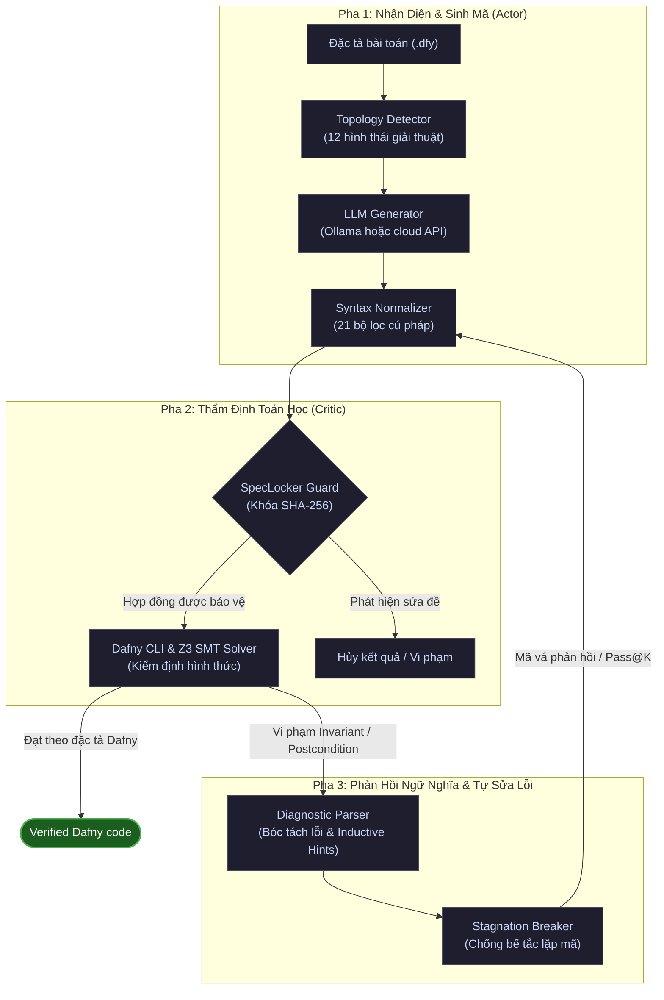

# TỔNG QUAN HỆ THỐNG FORMAL VERIFICATION-IN-THE-LOOP
**Dự án**: Nghiên cứu khung sinh mã nguồn và tự sửa lỗi tự động loại bỏ ảo giác dựa trên kiểm định logic hình thức (Formal Verification-in-the-Loop)

**Mốc tài liệu: v1.7.0, 18/10/2026.** Tập hồi quy hiện có 35 bài Dafny. Pilot mới gồm 20 bài DafnyBench, 30 issue Python và 10 ca bẫy đặc tả; 10 thuộc tính Python đang chờ người dùng rà soát. Xem [README](README.md), [hướng dẫn pilot](docs/REAL_WORLD_BENCHMARKS.md) và [bảng rà soát](docs/FORMAL_DRAFT_REVIEW.md) để chạy và hiểu phạm vi kết quả.

---

## 1. Mục Tiêu & Vấn Đề Khoa Học (Problem Statement)

### Vấn Đề Cốt Lõi:
- Các mô hình ngôn ngữ lớn (LLM như GPT, DeepSeek, Qwen) khi sinh mã thường gặp phải hiện tượng **ảo giác (hallucination)**: code nhìn có vẻ đúng về cú pháp nhưng vi phạm logic toán học, tràn số, sai sót ở các trường hợp biên (edge cases) hoặc lặp vô tận.
- Kiểm thử truyền thống chỉ quan sát hữu hạn đầu vào; kiểm chứng hình thức có thể chứng minh thuộc tính đã đặc tả cho mô hình Dafny, dưới các giả định của mô hình đó.

### Giải Pháp Của Hệ Thống:
- Tích hợp **Kiểm định logic hình thức (Formal Verification)** với ngôn ngữ **Dafny 4.x** và bộ giải **Z3 SMT Solver** vào vòng lặp sinh mã.
- Dafny chuyển các nghĩa vụ kiểm chứng của mã `.dfy` sang Z3. Trạng thái **verified** chỉ có nghĩa mã Dafny thỏa đặc tả đang xét; không chứng minh đặc tả phản ánh đủ yêu cầu nghiệp vụ hoặc bản vá Python đúng. Pilot Python dùng bộ chấm Python riêng.

---

## 2. Kiến Trúc Vòng Lặp Khép Kín (Closed-Loop Actor-Critic Architecture)

Đường ống kiểm chứng bài Dafny hoạt động theo ba pha sau; pilot Python có bộ chấm và báo cáo riêng:

---

## 3. Bốn Trụ Cột Kỹ Thuật Cốt Lõi

### Trụ Cột 1: Bộ Nhận Diện Hình Thái Giải Thuật ([core/topology_detector.py](core/topology_detector.py))
Phân loại bài toán thành **12 hình thái giải thuật** để cung cấp khung gợi ý cấu trúc (Inductive Skeleton) cho LLM:
1. `DIRECT`: Tính toán giải tích trực tiếp, cấm dùng vòng lặp (`abs_val`, `sign_function`, `truncate`).
2. `LINEAR_LOOP`: Duyệt mảng tuần tự với bất biến biên và tiền tố (`linear_search`, `max-element`, `below-threshold`).
3. `PURE_FUNC_EQUIV`: Tính tương đương hàm thuần túy/đệ quy hoặc quy nạp chuỗi (`count_elements`, `fib`, `sum_positive`).
4. `NESTED_LOOP`: Kiểm định cặp chỉ số tồn tại (`has_close_elements`) hoặc toàn thể (`is_array_sorted`, `all_unique`).
5. `NUMBER_THEORY`: Số học, Euclid GCD, số nguyên tố (`gcd`, `is_prime`).
6. `NON_LINEAR`: Số học phi tuyến tính bậc cao, căn bậc 3 (`iscube`).
7. `STRING_SEQUENCE`: Đảo chuỗi và đối xứng chuỗi inline (`is_palindrome`).
8. `PERMUTATION_SORT`: Sắp xếp mảng và bảo toàn đa tập hợp multiset (`sort_array`).
9. `BINARY_SEARCH`: Tìm kiếm nhị phân chia đôi chặn biên (`binary_search`).
10. `ORDERED_INSERT`: Chèn có thứ tự bảo toàn tính sắp xếp (`sorted_insert`).
11. `SEQ_CONSTRUCTION`: Xây dựng mảng mới, lọc phần tử (`copy_array`, `remove_element`, `array_reverse`).
12. `SEARCH_CONDITION`: Tìm kiếm có điều kiện phủ định biên (`linear_search_last`, `find_first_negative`).

### Trụ Cột 2: Chuẩn Hóa Cú Pháp Tự Động ([core/syntax_normalizer.py](core/syntax_normalizer.py))
Gồm **21 phép biến đổi Source-to-Source** sửa lỗi cú pháp mà mô hình 7B hay mắc phải:
- Khắc phục lỗi phủ định toán tử so sánh: `!s[i] <= s[j]` $\to$ `s[i] > s[j]`.
- Tự động bổ sung `var` khi gán biến mới.
- Ép kiểu số thực an toàn `floor as real`, khởi tạo biến boolean definite assignment.
- Tự chèn các bổ đề sắp xếp (`insert_multiset`, `insert_sorted`, `insert_len`) khi thiếu.

### Trụ Cột 3: Khóa Đặc Tả Chống Gian Lận ([core/spec_locker.py](core/spec_locker.py))
- Kiểm tra thay đổi hợp đồng Dafny, tiền điều kiện (`requires`), hậu điều kiện (`ensures`) và các giả định liên quan; `dafny audit` hỗ trợ phát hiện đường chứng minh chưa đáng tin cậy.
- Đặc tả quá yếu vẫn có thể được Dafny xác minh; vì vậy có bộ bẫy đặc tả và bước rà soát của người đánh giá.

### Trụ Cột 4: Chẩn Đoán Ngữ Nghĩa & Phá Vỡ Bế Tắc ([core/diagnostic_parser.py](core/diagnostic_parser.py))
- Bóc tách vết lỗi từ Z3: vi phạm bất biến vòng lặp (`LoopInvariantViolation`), vi phạm hậu điều kiện (`PostconditionViolation`), vượt biên mảng (`OutOfBounds`).
- Khi phát hiện mã sửa đổi bị trùng lặp $\ge 90\%$ giữa các vòng lặp (Stagnation), bộ điều khiển sẽ kích hoạt chiến thuật phá bế tắc, tăng nhiệt độ suy diễn để khám phá không gian giải pháp mới.

---

## 4. Danh Mục Benchmark & Kết Quả Thực Nghiệm

Tập hồi quy hiện có **35 bài Dafny**: 30 bài cốt lõi và 5 bài cây/danh sách liên kết. Bảng kết quả dưới đây là **số liệu lịch sử của 30 bài cốt lõi** từng được ghi trong README; báo cáo đối chứng ngày 15/10/2026 ghi 29/30 Pass@3 trong cấu hình khác. Không dùng hai bảng này làm kết quả của pilot Python.

| Nhóm Benchmark | Quy mô | Các bài toán tiêu biểu | Kết quả lịch sử được ghi |
| :--- | :---: | :--- | :---: |
| **Clover Benchmark (Stanford)** | 6 bài | `abs_val`, `find_min`, `linear_search`, `sample_max`, `sign_function`, `sum_to_n` | **100% (6/6)** |
| **HumanEval-Dafny (JetBrains)** | 10 bài | `000-has_close_elements`, `002-truncate`, `010-is_palindrome`, `013-gcd`, `031-is_prime`, `035-max_element`, `052-below_threshold`, `055-fib`, `077-iscube`, `088-sort_array` | **100% (10/10)** |
| **Advanced / Extended Benchmark** | 14 bài | `binary_search`, `linear_search_last`, `find_first_negative`, `array_reverse`, `is_array_sorted`, `remove_element`, `copy_array`, `count_elements`, `sum_positive`, `product_of_array`, `all_unique`, `matrix_row_sum`, `matrix_diagonal_sum`, `sorted_insert` | **100% (14/14)** |
| **Cốt lõi (lịch sử)** | **30 bài** | **Ba nhóm trên** | **30/30 trong báo cáo README cũ** |
| **Cấu trúc quy nạp** | **5 bài** | `bst_search`, `bst_insert`, `linked_list_reverse` | **Chưa gộp vào kết quả lịch sử** |

Ba bộ thử mới được chấm riêng: **DafnyBench20** kiểm tra khả năng hoàn thiện chứng minh; **Python pilot 30 issue** kiểm tra bản vá nhiều tệp bằng SWE-bench Docker; **Spec traps 10 ca** kiểm tra độ tin cậy đặc tả. Chưa có kết quả chấm đầy đủ cho hai tập đầu ở mốc tài liệu này.

---

## 5. Giao Diện Người Dùng & Các Chế Độ Hoạt Động ([app.py](app.py))

Giao diện Streamlit có **5 tab**: Kiểm định trực tiếp, So sánh mã, Báo cáo NCKH, So sánh chéo và Bộ thử nghiệm mới. Tab Kiểm định trực tiếp có 3 chế độ:
1. **Chế độ Đơn (`Single`)**: Chọn từng bài toán, tùy biến tham số `Pass@K`, `Timeout`, theo dõi tiến trình kiểm định từng lượt qua đồng hồ thời gian thực và xem mã verified tô màu cú pháp.
2. **Chế độ Hàng loạt (`Batch`)**: Chọn các bài trong tập 35 bài Dafny, chạy 1–4 case độc lập song song, xem kết quả và lưu lịch sử tại `artifacts/results/last_batch_run.json`.
3. **Chế độ Tự do (`Playground`)**: Cho phép người dùng tự viết đặc tả bài toán mới, nạp nhanh 3 mẫu chuẩn mực (Fibonacci, Kiểm tra mảng tăng dần, Đếm số chẵn), sau đó bấm nút để LLM tự sinh mã và Z3 kiểm định khép kín.

---

## 6. Thành phần mã nguồn hiện tại

- `core/pipeline_controller.py`, `core/dafny_engine.py`: vòng sửa mã Dafny và gọi bộ kiểm chứng.
- `core/batch_execution.py`, `core/token_tracker.py`: chạy nhiều case độc lập có giới hạn và lưu bộ đếm token khi đồng thời.
- `core/project_benchmark.py`, `core/project_context.py`, `agents/patch_agent.py`: đọc dự án Python, chọn context và tạo bản vá nhiều tệp.
- `experiments/run_benchmark.py`, `experiments/run_dafnybench20.py`, `experiments/run_project_suite.py`: ba runner chính; các CLI mặc định một worker.
- `web_demo/tabs/`, `docs/REAL_WORLD_BENCHMARKS.md`: giao diện và hướng dẫn cho các bộ thử hiện tại.
