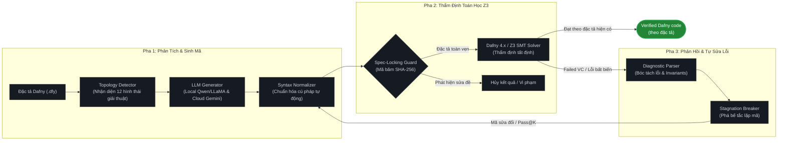

# Khung Sinh Mã Nguồn và Tự Sửa Lỗi Khép Kín Dựa Trên Kiểm Định Logic Hình Thức (Formal Verification-in-the-Loop)

[](https://www.python.org/)
[](https://github.com/dafny-lang/dafny)
[](https://github.com/Z3Prover/z3)
[](CHANGELOG.md)
[](data/benchmarks)
[](app.py)

Dự án này là mã nguồn thực nghiệm cho đề tài Nghiên cứu Khoa học: **"Nghiên cứu khung sinh mã nguồn và tự sửa lỗi tự động loại bỏ ảo giác dựa trên kiểm định logic hình thức (Formal Verification-in-the-Loop)"**. 

Hệ thống triển khai đường ống Actor-Critic khép kín thế hệ mới (**Neuro-Symbolic Deductive Repair Framework**) kết hợp sức mạnh suy diễn của các mô hình ngôn ngữ lớn (LLM cục bộ và đám mây) với tính đúng đắn toán học tất định của ngôn ngữ kiểm định **Dafny 4.x** và bộ giải **Z3 SMT Solver**.

**Mốc tài liệu hiện hành: v1.7.0, cập nhật 18/10/2026.** Tập hồi quy gồm **35 bài Dafny** (30 bài cốt lõi và 5 bài cấu trúc quy nạp). Thí điểm mới có **20 bài DafnyBench, 30 issue Python, 10 ca bẫy đặc tả**; 10 bản nháp thuộc tính Python đang chờ người dùng rà soát. Giao diện Streamlit có 5 tab; chạy hàng loạt và các CLI benchmark hỗ trợ song song có giới hạn. Xem [hướng dẫn bộ thử mới](docs/REAL_WORLD_BENCHMARKS.md), [bản nháp đặc tả](docs/FORMAL_DRAFT_REVIEW.md) và [nhật ký thay đổi](CHANGELOG.md).

**Phạm vi kết luận:** `dafny verify` chứng minh mã Dafny theo đặc tả đã cung cấp, không chứng minh toàn bộ mã Python. Bản vá Python chỉ được tính đạt khi đã chạy bộ chấm Python; các thuộc tính Dafny chưa được rà soát không được tính là đã chứng minh.

---

## 1. Tổng Quan Kiến Trúc (Architecture Overview)

Quy trình vận hành theo cơ chế vòng lặp Actor-Critic khép kín gồm 3 phân vùng chức năng chính:



### Các nguyên lý cốt lõi:
* **Algorithmic Topology Detection**: Tự động nhận diện **12 hình thái giải thuật** (Direct, Linear Loop, Nested Loop, Pure Function Equivalence, Number Theory, Non-Linear Arithmetic, Binary Search, Array Reversal, Sequence Construction, Ordered Insertion, Search Condition, Matrix Diagonal/Row Sum) nhằm cung cấp khung inductive invariant chuẩn mực, ngăn chặn LLM sinh vòng lặp rác.
* **Spec-Locking Protocol**: Kiểm tra hợp đồng Dafny và các giả định liên quan trước khi chấp nhận mã sinh; `dafny audit` hỗ trợ phát hiện phần chứng minh dựa trên giả định chưa được chứng minh. Chất lượng đặc tả vẫn cần người đánh giá rà soát.
* **Automated Syntax Normalization**: Bộ phép biến đổi cấp độ ngữ nghĩa (Source-to-Source) tự động làm sạch lỗi cú pháp, ép kiểu `.Floor as real`, khởi tạo definite-assignment, chuẩn hóa phủ định so sánh và inductive invariants.
* **Semantic Diagnostic Engine**: Bóc tách lỗi kiểm chứng Dafny/Z3, cung cấp gợi ý về bất biến và phản ví dụ nếu công cụ trả về để hướng dẫn vòng sửa.
* **Stagnation Breaker**: Tự động nhận diện hiện tượng lặp lại mã sai giữa các vòng lặp ($\ge 90\%$) để tăng nhiệt độ và đổi chiến lược suy diễn, phá vỡ bế tắc lặp mã.
* **Cross-Model Evaluation & Token Tracking**: Hệ thống so sánh đối đầu đa mô hình (Local Ollama vs Cloud Google Gemini / OpenAI) kèm bộ đếm Token kiên cố trích xuất chuẩn xác từ Google AI Studio REST API.
* **High-Cap Reasoning Optimization**: Nâng ngưỡng trần token sinh mã (`maxOutputTokens: 8192`) và cơ chế tính trễ thích ứng (Dynamic Retry Delay) xử lý triệt để bẫy cạn token do quá trình suy luận ngầm (Internal Thinking) của mô hình Reasoning thế hệ mới.

---

## 2. Cấu Trúc Thư Mục Dự Án

```text
Formal_Verification-in-the-Loop/
├── configs/
│   └── experiment_config.yaml   # Cấu hình K_max, timeout, mô hình mặc định
├── core/
│   ├── __init__.py
│   ├── dafny_engine.py          # Wrapper tương tác với Dafny CLI qua subprocess
│   ├── spec_locker.py           # Module SHA-256 bảo vệ tính toàn vẹn đặc tả toán học
│   ├── diagnostic_parser.py     # Parser bóc tách trace lỗi SMT và sinh Actionable Directives
│   ├── template_preserver.py    # Bảo toàn template chữ ký hàm, type signature và ensures
│   ├── syntax_normalizer.py     # Chuẩn hóa cú pháp tự động đa quy tắc
│   ├── topology_detector.py     # Phân loại 12 hình thái bài toán và ràng buộc cấu trúc
│   ├── ast_localizer.py         # Định vị và vá cục bộ khối Invariant cấp độ AST
│   ├── cross_model_evaluator.py # Đối đầu đa mô hình và checkpoint
│   ├── batch_execution.py       # Điều phối các case độc lập song song có giới hạn
│   ├── project_benchmark.py     # Áp dụng và đánh giá bản vá Python nhiều tệp
│   ├── project_context.py       # Chọn context có giới hạn, lưu bằng chứng
│   ├── project_formal.py        # Kiểm chứng/audit mô hình Dafny theo dự án
│   ├── token_tracker.py         # Bộ đếm token Gemini/Groq an toàn khi chạy song song
│   └── pipeline_controller.py   # Vòng lặp kiểm chứng và tự sửa Pass@K
├── agents/
│   ├── __init__.py
│   ├── llm_agent.py             # Agent sinh mã Dafny qua LiteLLM/Gemini
│   └── patch_agent.py           # Agent sinh bản vá Python qua LiteLLM
├── data/
│   ├── benchmarks/
│   │   ├── clover/              # 6 bài Dafny
│   │   ├── humaneval_dafny/     # 10 bài Dafny
│   │   ├── advanced/            # 14 bài Dafny
│   │   ├── advanced_inductive/  # 5 bài cây/danh sách liên kết
│   │   ├── dafnybench20/        # 20 bài khôi phục gợi ý chứng minh
│   │   ├── python_projects/     # 30 manifest issue Python, 10 bản nháp đặc tả
│   │   └── spec_traps/          # 10 ca kiểm tra độ tin cậy đặc tả
│   └── raw/                     # Dữ liệu đầu vào chuẩn hóa JSONL
├── experiments/
│   ├── __init__.py
│   ├── run_benchmark.py         # Script chạy thực nghiệm tự động hàng loạt
│   ├── run_cross_model_benchmark.py # CLI đối đầu đa mô hình
│   ├── run_dafnybench20.py      # Khôi phục gợi ý chứng minh
│   ├── run_project_task.py      # Sinh bản vá cho một issue Python
│   ├── run_project_suite.py     # Chạy 30 issue ở baseline/framework
│   ├── run_spec_traps.py        # Kiểm tra bẫy đặc tả
│   └── evaluate_project_reports.py # Tổng hợp kết quả Python
├── web_demo/tabs/               # 5 tab Streamlit
├── docs/                        # Hướng dẫn pilot và bảng rà soát đặc tả
├── tests/                       # Kiểm thử tự động
├── artifacts/
│   ├── logs/                    # Trace chi tiết của từng lượt chứng minh Z3
│   └── results/                 # Dữ liệu xuất ra (JSON/CSV/LaTeX/Checkpoints) lưu trữ bền vững
├── requirements.txt             # Danh sách thư viện phụ thuộc
├── CHANGELOG.md                 # Nhật ký thay đổi chi tiết theo phiên bản
├── PROJECT_OVERVIEW.md          # Tài liệu tổng quan kiến trúc học thuật phục vụ báo cáo
└── README.md
```

---

## 3. Danh Mục 35 Bài Toán Dafny Hồi Quy (Benchmark Suite)

Tập cũ gồm **30 bài cốt lõi** bao phủ các hình thái giải thuật chính, cộng **5 bài cấu trúc quy nạp**. Các tập mới được chấm và báo cáo riêng.

| Nhóm Benchmark | Quy mô | Danh sách bài toán tiêu biểu | Các hình thái giải thuật kiểm định |
| :--- | :---: | :--- | :--- |
| **Clover** | 6 bài | `abs_val`, `find_min`, `linear_search`, `sample_max` | Số học, mảng và tìm kiếm |
| **HumanEval-Dafny** | 10 bài | `002-truncate`, `013-greatest_common_divisor`, `031-is-prime`, `055-fib` | Số học, chuỗi và vòng lặp |
| **Advanced Algorithms** | 14 bài | `binary_search`, `array_reverse`, `matrix_row_sum`, `sorted_insert` | Mảng, ma trận và bất biến vòng lặp |
| **Advanced Inductive Structures** | 5 bài | `bst_search`, `bst_insert`, `linked_list_reverse` | Cây và danh sách liên kết |

---

## 4. Yêu Cầu Hệ Thống & Cài Đặt

### 4.1. Yêu cầu môi trường
* **Hệ điều hành**: Windows 10/11, Linux (Ubuntu 20.04+), macOS.
* **Python**: Phiên bản 3.10 trở lên (khuyên dùng Python 3.11 - 3.13).
* **Dafny**: Phiên bản 4.x (tích hợp sẵn Z3 SMT Solver).
* **Ollama**: Chỉ cần nếu dùng mô hình cục bộ; có thể chạy bằng API cloud và không cài Ollama.

### 4.2. Cài đặt Dafny CLI
1. Tải bản nén `.zip` từ [Dafny Releases (GitHub)](https://github.com/dafny-lang/dafny/releases).
2. Giải nén vào `tools/dafny/`, thêm thư mục chứa lệnh `dafny` vào `PATH`, hoặc đặt `DAFNY_PATH` trỏ tới file thực thi tương ứng với hệ điều hành.
3. Kiểm tra trạng thái cài đặt:
```bash
dafny --version
# Kết quả yêu cầu: Dafny 4.x.x
```

### 4.3. Cài đặt môi trường Python & Cấu hình Khóa Bảo Mật
```bash
# Tạo và kích hoạt môi trường ảo
python -m venv .venv
source .venv/bin/activate    # Linux / macOS
# .venv\Scripts\activate   # Windows PowerShell: .venv\Scripts\Activate.ps1

# Cài đặt các thư viện phụ thuộc
pip install -r requirements.txt

# Thiết lập file cấu hình môi trường bảo mật
cp .env.example .env
```

Điền các thông số tương ứng vào `.env`. Không đưa khóa API vào commit hoặc báo cáo công khai:
```env
DAFNY_PATH="/duong/dan/den/dafny"   # Linux/macOS; Windows dùng Dafny.exe
GEMINI_API_KEY="your-google-ai-studio-gemini-key"
# OPENAI_API_KEY="your-openai-api-key"  # Chỉ khi dùng OpenAI
DEEPSEEK_API_KEY="your-deepseek-api-key"  # Chỉ khi dùng DeepSeek API
```

Chạy lệnh từ **thư mục gốc `Formal_Verification-in-the-Loop`**, nơi có `requirements.txt` và `app.py`. Với CLI benchmark cũ, truyền `--model gemini-2.5-flash` hoặc tên mô hình cloud đang dùng; nếu bỏ cờ này, cấu hình hiện tại mặc định `ollama/qwen2.5-coder:7b`.

### 4.4. Chuẩn bị Mô hình Cục bộ qua Ollama (Tùy chọn)
Nếu chạy thử nghiệm các mô hình cục bộ (Local AI):
```bash
# Tải mô hình lập trình chuyên biệt Qwen 2.5 Coder 7B
ollama pull qwen2.5-coder:7b

# Tải mô hình đa dụng LLaMA 3.1 8B
ollama pull llama3.1:8b
```

---

## 5. Hướng Dẫn Vận Hành & Thực Nghiệm

### 5.1. Chạy kiểm thử tự động toàn bộ Unit Tests
Kiểm tra bộ kiểm thử tự động trước khi chạy thực nghiệm:
```bash
python -m pip install pytest  # Công cụ kiểm thử, chưa nằm trong requirements.txt
python -m pytest tests -q
```
Lần chạy gần nhất ngày 18/10/2026: **125 bài kiểm thử đạt**. Đây là kết quả kiểm thử phần mềm, không phải tỷ lệ vượt benchmark hay chứng minh mã Python.

### 5.2. Chạy Benchmark đánh giá qua CLI
```bash
# 1. Chạy các tập Dafny cũ qua Gemini API
python -m experiments.run_benchmark --benchmark clover --model gemini-2.5-flash
python -m experiments.run_benchmark --benchmark humaneval_dafny --model gemini-2.5-flash
python -m experiments.run_benchmark --benchmark advanced --model gemini-2.5-flash
python -m experiments.run_benchmark --benchmark advanced_inductive --model gemini-2.5-flash

# Chạy các bài độc lập song song khi hạn mức API cho phép (1-8 workers)
python -m experiments.run_benchmark --benchmark advanced --model gemini-2.5-flash --workers 2

# 2. Chạy Benchmark Đối Đầu Đa Mô Hình (Cross-Model Evaluation)
# Chạy mẫu 5 bài tiêu biểu:
python experiments/run_cross_model_benchmark.py --models qwen gemini-3.5 llama --preset sample

# Chạy 10 bài HumanEval-Dafny:
python experiments/run_cross_model_benchmark.py --models qwen gemini-3.5 llama --preset humaneval

# Chạy toàn bộ các bài theo preset của CLI đối đầu:
python experiments/run_cross_model_benchmark.py --models qwen gemini-3.5 llama --preset all

# Chạy 30 bài Dafny cốt lõi bằng DeepSeek API (không cần Ollama)
python experiments/run_cross_model_benchmark.py --models deepseek/deepseek-flash --preset core30
```

*Các cờ tùy chọn nâng cao của CLI:*
* `--models`: Danh sách mô hình; alias hiện có gồm `qwen`, `deepseek`, `llama`, `gemini-2.5`, `gemini-3.5`, `gemini-3.6`, `groq-qwen`, `groq-120b`, `groq-20b`. Có thể truyền tên mô hình LiteLLM trực tiếp; mô hình khả dụng còn tùy khóa API và nhà cung cấp.
  Lưu ý: alias `deepseek` trỏ tới Ollama cục bộ; để dùng API key, nhập đầy đủ `deepseek/deepseek-flash`.
* `--preset`: Bộ lọc bài toán (`sample`, `core`, `clover`, `humaneval`, `core30`, `all`); `all` là 35 bài Dafny.
* `--max-attempts`: Số lượt sinh và sửa tối đa (mặc định `3`).
* `--workers`: Số bài chạy đồng thời (mặc định `1`); `--resume` tiếp tục từ checkpoint, `--no-cache` tắt bộ đệm SMT.

### 5.3. Khởi chạy Giao diện Web Demo Tương tác (Streamlit UI)
```bash
streamlit run app.py
```
Ứng dụng sẽ tự động khởi chạy tại: `http://localhost:8501`.
Trong tab **Bộ thử nghiệm mới**, chọn nhóm **DafnyBench20** để thấy nút **Chạy cả 20 bài DafnyBench**, hoặc chọn **Python pilot** để thấy nút **Chạy cả 30 issue Python**. Nút chạy cả tập chỉ xuất hiện ở nhóm tương ứng. Ô **Mô hình LiteLLM** là danh sách chọn các mô hình đang có trong ứng dụng; mục **Mô hình khác…** cho phép nhập tên LiteLLM tùy ý. Cần cấu hình API key hoặc Ollama tương ứng trước khi chạy. Mỗi tập chạy nền và lưu tiến độ, nhật ký, báo cáo dưới `artifacts/results/new_benchmarks/suite_runs/`. Nếu không bật chấm Docker/SWE-bench, 30 issue Python mới tạo bản vá và chưa có kết luận từ bài kiểm tra ẩn.

**5 tab chức năng trên Web Demo:**
* **⚡ Tab 1 - Kiểm Định Trực Tiếp (Live Verification)**: 
  * Chế độ **Đơn**: Trực quan hóa hình thái giải thuật, mã băm SHA-256 khóa đặc tả và quá trình Actor-Critic tự sửa lỗi.
  * Chế độ **Hàng loạt**: Bảng tiến trình trực tiếp, bộ chọn bài toán và tùy chọn chạy 1–4 bài độc lập song song.
  * Chế độ **Tự do (Playground)**: Cho phép nhập mã Dafny tùy ý hoặc nạp mẫu nhanh để thẩm định Z3.
* **Tab 2 - So Sánh Mã (Code Diff Viewer)**: Hiển thị khác biệt giữa mã ban đầu và mã Dafny đã đạt kiểm chứng theo đặc tả.
* **📊 Tab 3 - Báo Cáo NCKH (Scientific Dashboard)**: Thống kê chỉ số Pass@1 vs Pass@K, tỷ lệ phục hồi tự sửa (RSR), ma trận phân loại lỗi SMT Solver và bảng xuất báo cáo.
* **⚔️ Tab 4 - So Sánh Chéo (Cross-Model Evaluation)**: Đối đầu trực tiếp giữa Local AI (Qwen 7B, LLaMA 8B) và Cloud AI (Google Gemini 3.5/2.5 Flash), hiển thị bảng nhật ký từng bài theo thời gian thực (Live Task Stream Log), biểu đồ so sánh đa chiều và sinh mã bảng LaTeX chuẩn cho bài báo khoa học.
* **Tab 5 - Bộ thử nghiệm mới**: Chạy từng bài DafnyBench20, từng issue Python hoặc 10 ca bẫy đặc tả; xem báo cáo của từng bộ kiểm tra riêng biệt.

---

## 6. Kết Quả Thực Nghiệm Trên Bài Toán Dafny (Empirical Evaluation)

> Các bảng dưới đây ghi lại những lần chạy lịch sử trên bài toán Dafny độc lập. Báo cáo đối chứng ngày 15/10/2026 ghi **29/30 Pass@3**, khác với bảng 30/30 bên dưới; cần nêu rõ cấu hình và dữ liệu thô của từng lần chạy trước khi so sánh. Chưa có kết quả chấm 30 tác vụ Python bằng Docker. Hướng dẫn tập thử mới: [Đánh giá agent coding trên dự án Python](docs/REAL_WORLD_BENCHMARKS.md).

### 6.1. Kết quả 30/30 được ghi trong báo cáo README trước đây (Qwen2.5-Coder-7B)
Bảng lịch sử dưới đây ghi lần chạy được báo cáo đạt 30/30. Chưa dùng bảng này để kết luận hiệu năng trên dự án Python hoặc thay thế báo cáo đối chứng 29/30 ngày 15/10/2026:

| Tập Benchmark | Quy mô | Pass@1 (Zero-shot) | Pass@3 (Formal-in-the-Loop) | Tỷ lệ Tự Sửa Lỗi (RSR) | Kết Quả Z3 |
| :--- | :---: | :---: | :---: | :---: | :---: |
| **Clover Benchmark (Stanford)** | 6 bài | 66.7% (4/6) | **100.0% (6/6)** | **100.0%** (2/2) | **6/6 Verified (100%)** |
| **HumanEval-Dafny (JetBrains)** | 10 bài | 80.0% (8/10) | **100.0% (10/10)** | **100.0%** (2/2) | **10/10 Verified (100%)** |
| **Advanced Algorithms (Mở Rộng)** | 14 bài | 78.6% (11/14) | **100.0% (14/14)** | **100.0%** (3/3) | **14/14 Verified (100%)** |
| **TỔNG HỢP TOÀN BỘ** | **30 bài** | **76.7% (23/30)** | **100.0% (30/30)** | **100.0% (7/7)** | **🏆 30/30 Đạt Chứng Minh 100%** |

### 6.2. Ma trận so sánh đối đầu đa mô hình (Cross-Model Benchmark)
Kết quả so tài năng lực sinh mã kèm kiểm chứng hình thức trên tập bài toán chuẩn:

| Mô Hình | Loại Mô Hình | Quy Mô | Pass@1 (%) | Pass@K (%) | Thời Gian TB ($T_{avg}$) | Số Vòng Lặp Sửa TB |
| :--- | :--- | :---: | :---: | :---: | :---: | :---: |
| **Qwen2.5-Coder-7B** | Local (Ollama) | 10 bài | **90.0%** | **100.0%** | 47.6s | 0.1 |
| **LLaMA-3.1-8B** | Local (Ollama) | 10 bài | **50.0%** | **60.0%** | 108.9s | 0.6 |
| **Gemini 3.5 Flash** | Cloud (Google AI) | 10 bài | **80.0%** | **90.0%** | **12.4s** | 0.2 |

> **Phân tích thực nghiệm:**
> 1. **Qwen 2.5 Coder 7B**: Thể hiện sự vượt trội trong việc hiểu cú pháp Dafny và bám sát các mệnh đề bất biến (invariants) được sinh từ Topology Detector, đạt tỷ lệ sửa thành công tuyệt đối khi có phản hồi hình thức từ Z3.
> 2. **Gemini 3.5 Flash**: Sở hữu tốc độ vượt trội (chỉ ~12s/bài), phản hồi cực nhanh. Sau khi được tối ưu hóa trần token `8192` và loại bỏ chỉ dẫn phạm vi biến cứng nhắc, Gemini đã hoàn toàn giải quyết được các bài toán phức tạp (`truncate`, `gcd`, `is_prime`, `fibonacci`).
> 3. **LLaMA 3.1 8B**: Mặc dù có năng lực lập trình cơ bản tốt, LLaMA gặp khó khăn hơn với các cú pháp đặc tả hình thức Dafny chuyên sâu và cần nhiều vòng lặp tự sửa lỗi hơn.

---

## 7. Tài Liệu Tham Khảo Nền Tảng (Key References)

1. **Clover**: Sun, C. et al. (Stanford University, 2024). *Clover: Closed-Loop Verifiable Code Generation*. arXiv:2310.17807.
2. **AI Hallucination Classification**: Nature (Humanities & Social Sciences Communications, 2024). *AI hallucination: towards a comprehensive classification of distorted information in artificial intelligence-generated content*. DOI: 10.1057/s41599-024-03811-x.
3. **Reasoning Models & Hallucination**: arXiv (2025). *Detection and Mitigation of Hallucination in Large Reasoning Models: A Mechanistic Perspective*. arXiv:2505.12886.
4. **Self-Correction in LLMs**: arXiv (2025). *Boosting LLM Reasoning via Spontaneous Self-Correction*. arXiv:2506.06923.
5. **Specification-Guided Self-Repair**: IEEE/ACM Transactions on Software Engineering (2026). *Specification-Guided Self-Repair in Code LLMs: Bridging SMT Solvers and Neuro-Symbolic Pipelines*.
6. **Dafny & Z3**: Leino, K. R. M. (Microsoft Research). *Dafny: An Automatic Program Verifier for Functional Correctness*.
